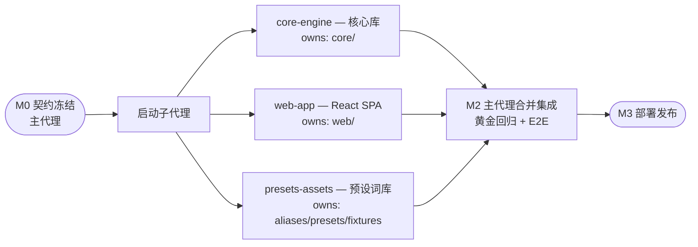

# BOM 工具通用化改造实施计划
## 问题陈述
现有 jlc_bom_converter 是为单一公司定制的桌面工具：输入锁死嘉立创 EDA 列名、物料库锁死金蝶格式、输出硬编码公司 PCBA 模板。目标是改造为通用在线工具：任意 EDA BOM 输入、任意物料库、可视化列映射与输出模板标注、匹配规则可配置、结果在线预览修正，并可推广给外部用户。
## 已确认的关键决策
* 处理架构：纯前端本地处理。文件不上传服务器，Pyodide 在浏览器 Web Worker 中运行 Python 核心。零服务器成本、免备案、隐私即卖点。
* 前端：React + TypeScript + Vite + Ant Design 5（状态用 Zustand，大表格用 AntD 虚拟滚动/TanStack Table）；Excel 前端解析用 SheetJS（顺带免费获得 .xls 老格式支持）。选型依据：AI 代理开发下 React+TS 训练语料密度最高、数据密集型 UI 生态最强，不考虑维护者既有技术栈。
* 仓库：新建独立 monorepo，路径 `/Users/peyoba/Documents/Obsidian Vault/项目/bomkit`（工作名 bomkit，产品名后定；子代理 worktree 为其同级目录 `项目/bomkit-wt-*`）。现仓库保留不动供公司内部使用。
* MVP 无账号体系：配置存 localStorage + 导出/导入 JSON 文件共享。
* 核心重构时移除 pandas 依赖（仅保留 openpyxl 用于写 xlsx）：Pyodide 载荷从 ~30MB 降到 ~10MB，也使未来 PyInstaller 打包体积大幅缩小。读取侧由 SheetJS（Web）或 openpyxl（CLI）承担。
## 现状要点
* 核心逻辑集中在 `jlc_bom_converter_core.py`（~1040 行单类），已有清晰内聚分区：R/C 参数解析（278-458 行）、五级匹配（460-609 行）、分组排序（625-667 行）、Excel 渲染（671-933 行）、公式注入防护（984-1008 行）。注释中沉淀了大量边界 case（Ω/μ/µ Unicode、m/M 毫欧兆欧区分、公制英制封装映射、金蝶编码前导零），重构必须完整保留。
* `tests/` 下有 pytest 回归测试（匹配置信度、数值解析、物料表加载、输出安全、端到端），是重构的安全网，需随迁移。
* CLI（`jlc_bom_converter.py`）与 tkinter GUI 是核心类的薄壳。
## 目标架构
### 仓库结构（monorepo）
```warp-runnable-command
bomkit/
├── core/                    # Python 包 bomcore（纯逻辑，仅依赖 openpyxl）
│   ├── pyproject.toml       # 构建 pure-python wheel（供 Pyodide 加载与 pip 安装）
│   ├── src/bomcore/
│   │   ├── models.py        # 标准中间模型 dataclass
│   │   ├── schema.py        # 字段注册表 + Profile 校验（带 schema_version）
│   │   ├── detect.py        # 表头行探测 + 列名猜测（别名词库+内容验证+置信度）
│   │   ├── aliases/*.json   # 列名别名词库（数据文件，持续积累）
│   │   ├── parse_rc.py      # R/C 值解析（自现核心 278-458 行迁移）
│   │   ├── matching.py      # 可配置级联匹配管线（自 460-609 行迁移）
│   │   ├── grouping.py      # 分组合并/排序（自 625-667 行迁移，去 pandas）
│   │   ├── render.py        # 模板驱动 openpyxl 渲染（自 671-933、984-1008 行迁移）
│   │   ├── presets/*.json   # 内置 Profile：嘉立创EDA/KiCad/Altium/立创EDA标准版/金蝶物料表/旧简易表/默认输出模板
│   │   └── api.py           # 稳定门面：analyze() / render()，供 CLI 与 Web Worker 共用
│   └── tests/               # 迁移现有 pytest + 新增 detect/profile 测试
├── cli/                     # 新 CLI（薄壳，兼容旧参数）
└── web/                     # React SPA
    ├── public/pyodide/      # 自托管 Pyodide runtime + openpyxl wheel + bomcore wheel
    └── src/
        ├── workers/pyodide.worker.ts   # Worker 内加载 Pyodide，暴露 analyze/render
        ├── lib/xlsx.ts                 # SheetJS 读取→行 JSON；lib/profiles.ts 本地存储+指纹匹配+导入导出
        ├── pages/Home.tsx（落地页）、Wizard.tsx（向导）、Preview.tsx（预览修正）
        └── components/MappingTable.tsx、TemplateAnnotator.tsx、CandidatePicker.tsx
```
### 标准中间模型（枢纽，一切映射围绕它）
* BomItem 字段：`designator, qty, value, footprint, mpn, manufacturer, description, category, tolerance, dnp, extras{}`（现列名对应：Designator→designator, Quantity→qty, Name→value, Footprint→footprint, Device→mpn, Comment→description, Secondary Category→category）。
* MaterialItem 字段：`code, name, spec, status, category, extras{}`。
* 字段 ID 固定为英文，schema 带版本号，旧 Profile 向前兼容。
### Profile 格式（JSON，三种 kind 同构）
* `bom_input` / `material_input`：`{schema_version, kind, name, header_fingerprint, column_map: {源列名→字段ID}, options}`。指纹 = 规范化表头集合，用于上传文件后自动套用已存 Profile。
* `output_template`：`{schema_version, kind, name, base_xlsx_b64, data_start_row, column_map: {列字母→字段ID}, meta_cells: {单元格→元数据字段}, style_options}`。即"上传现有模板 Excel + 可视化标注"，openpyxl 加载模板保留原样式后填数。内置默认模板 = 现公司 PCBA 模板（程序化重建现 create_excel 输出）。
* 匹配配置：级联各级开关与参数（子串最小长度默认 6、参数匹配开关、候选优先前缀默认 `01.`——现硬编码需参数化）。
### Worker API 契约（JS ↔ Pyodide，M0 冻结）
* `analyze(bom_rows, material_rows, bom_profile, material_profile, match_config) → {items: [每行含映射后字段+匹配结果+状态+候选列表], stats}`——供预览表格渲染。
* `render(final_items, output_profile, meta) → xlsx_bytes`——用户在预览中选完候选/修正后调用，Blob 下载。
* `detect(rows, kind) → {header_row_index, columns: [{source, guess_field, confidence, samples}]}`。
* 表头探测与映射预览纯前端即时完成（SheetJS 读前 50 行），选完文件立刻出映射界面，无需等 Pyodide 就绪。
### 用户流程
上传 BOM → 确认列映射（自动预填，绿色高置信/黄色待确认）→ 上传物料库（可选）+ 确认映射 → 选择/标注输出模板 → 转换 → 在线预览（颜色状态、候选行单选、手动改编码）→ 下载。每步配置自动存为 Profile，指纹命中时二次使用直达"上传→转换→下载"。
## 实施里程碑
### M0 仓库与契约（主代理，先行）
初始化 monorepo 与工具链；定稿 models/schema/Profile JSON Schema/Worker API 契约文档（`docs/contracts.md` + JSON Schema 文件）；准备契约示例 fixture（一组 rows JSON + 期望 analyze 输出），作为 web 子代理的 mock 依据；把现仓库样例 xlsx（嘉立创 BOM、金蝶物料表、公司模板、现工具输出）复制进 `core/tests/fixtures/` 作黄金基准。
### M1 并行开发（3 个本地子代理，见 Orchestration）
核心库重构、Web 应用、预设与词库三线并行。
### M2 集成与端到端验证（主代理）
合并三分支；构建 bomcore wheel 放入 `web/public/pyodide/`；打通真实链路替换 mock；黄金回归：同一输入经"默认预设+公司模板"走新链路，输出与旧工具逐单元格比对等价；Playwright E2E（上传→映射→转换→下载）；加载体验优化（进度条、Service Worker 缓存 Pyodide 资源）。
### M3 部署与发布（主代理）
静态部署到 Cloudflare Pages（免费免备案；国内加速列入 backlog）；落地页文案（隐私卖点：文件不出本机）；README 与用户指引；准备推广贴（立创社区/电子发烧友）素材。
### Post-MVP backlog（不在本期）
账号体系与云端配置、立创商城 API 查价/库存、BOM 版本对比、别名词库匿名反馈渠道、国内 CDN+备案域名、英文界面、核心 TS 移植评估。
## Orchestration
**Decision**: M0 契约冻结后启动 3 个本地子代理并行开发互不重叠的目录（core/web/预设资产），可将 M1 墙钟时间压缩约三分之二；集成、回归与部署由主代理串行完成。
**Dependencies and ordering**: M0（主代理：仓库骨架+契约+fixture）→ 三子代理并行（web 依赖契约 mock，不依赖真实 core）→ 全部完成后 M2 主代理集成验证 → M3 部署。计划批准后才启动子代理。
**Launch config**: 以本计划附带的 orchestration config 为准（本地执行、继承模型）；三个子代理同批启动。
**Child agents**:
* core-engine — Python 核心库
    * 摘要：在 worktree 中将旧核心重构为 bomcore 包（去 pandas、模块拆分、匹配管线参数化、模板标注渲染），迁移并扩充 pytest，产出 wheel；旧仓库只读参考。
    * 工作区：`git worktree add ../bomkit-wt-core -b feat/core main`，只改 `core/`。
    * 验证：pytest 全绿 + 黄金 fixture 对比；完成时报告分支名、测试结果、wheel 路径。
* web-app — React SPA
    * 摘要：搭建 Vite 工程与向导/映射/预览/下载全流程 UI，Worker 先接契约 mock（M0 fixture），Pyodide 加载设施用占位 wheel 演练；落地页含隐私说明。
    * 工作区：`git worktree add ../bomkit-wt-web -b feat/web main`，只改 `web/`。
    * 验证：vitest（指纹/映射逻辑）+ mock 链路手动走通；完成时报告分支名与 dev server 启动方式。
* presets-assets — 预设与词库
    * 摘要：调研 KiCad/Altium/立创EDA标准版 BOM 导出列名，编写 aliases 词库与内置 Profile JSON，制作各格式测试 fixture xlsx；只改 `core/src/bomcore/aliases|presets` 与 `core/tests/fixtures`。
    * 工作区：`git worktree add ../bomkit-wt-assets -b feat/assets main`。
    * 验证：JSON 通过 schema 校验；完成时报告调研来源与文件清单。
**Merge strategy**: 主代理按 feat/core → feat/assets → feat/web 顺序合入 main（目录互斥，冲突预期极少），随后统一集成验证；MVP 阶段单仓库本地合并，不开 PR，M3 时再推 GitHub 远端。

## 验证策略
* 单元层：现有 pytest 全量迁移（匹配置信度、R/C 解析、编码前导零、公式注入）+ 新增表头探测/Profile 校验/指纹匹配测试。
* 黄金回归：旧工具输出 xlsx 作为基准，新链路（默认预设+公司模板）输出逐单元格比对（值+关键样式），保证公司内部场景零回归。
* E2E：Playwright 驱动真实浏览器完成完整向导流程，校验下载文件内容；手动在 Excel/WPS 打开验收样式。
## 工作量与风险
估算（代理执行 + 你评审）：M0 约半天；M1 并行 2-4 天；M2 1-2 天；M3 约 1 天——合计约 1-1.5 周墙钟。若纯人工开发约 6-10 周业余时间。
主要风险与对策：
* Pyodide 首载体积（去 pandas 后约 8-12MB gzip）：加载进度条 + Service Worker 缓存 + 资源自托管；首载慢是一次性成本。
* 词库覆盖不足导致自动识别差：映射向导本身就是兜底，页面留反馈入口收集未识别列名。
* 国内访问 Cloudflare Pages 不稳：MVP 接受，backlog 中以腾讯云 EdgeOne/COS + 备案域名解决。
* 双份核心维护：旧仓库冻结只修 bug，公司内部使用逐步切换到新 CLI（同一 bomcore）。
